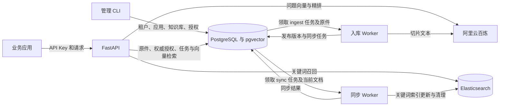
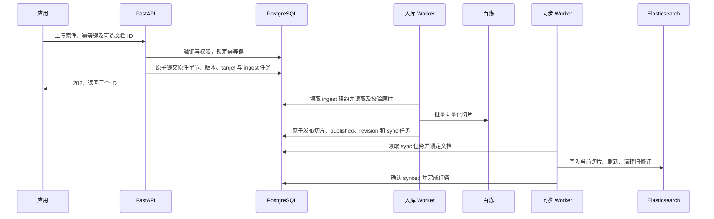
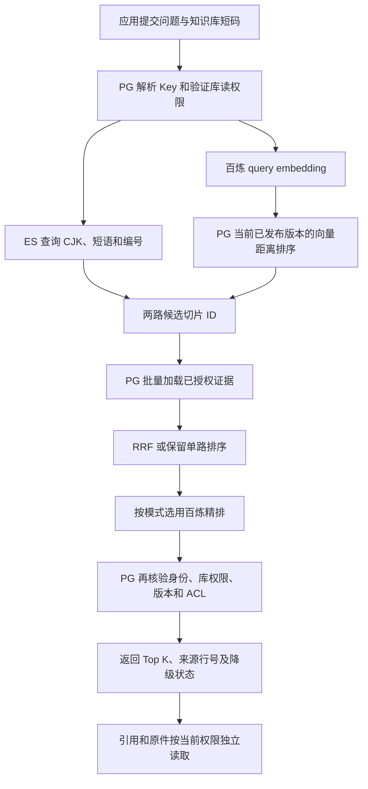

# RAG 当前实现与数据流

2026 年 11 月 17 日 · 以原件迁入 PostgreSQL 后的工作区为准

## 当前系统的边界

`rag/` 已形成可运行的多租户证据检索服务。应用通过 API Key 连接知识库，上传 Markdown 或 TXT，后台完成切分、向量化、版本发布和关键词索引。原件、权限、版本、切片和任务存于 PostgreSQL，Elasticsearch 提供关键词召回。在线查询可走 pgvector、Elasticsearch、RRF 和百炼精排，返回经授权的切片、文档版本、原文行号和下载入口。首期的产品接口止于证据返回。带引用的答案生成、终端用户和用户组、PDF/DOCX、RAGAS 及 Agentic RAG 属于后续交付。 [首期设计](../plan/design.md) · [业务 API](../../rag/api.py)

`poc/` 承担早期检索消融和 RAGFlow 对照。业务链使用 `rag/` 自己的鉴权、版本和索引实现。业务基准通过真实 `/v1/retrieve` 请求复用 `poc/` 的题集和评分函数，因此 PoC 分数可做历史参照，业务 API 的测试结果更适合衡量现在的实现。 [PoC](../../poc/README.md) · [业务基准](../../rag/benchmark.py) · [历史报告](poc-results.md)

## 技术实现拆分

| 技术点 | 当前实现 | 主要代码 |
| --- | --- | --- |
| HTTP 与进程 | FastAPI 和 Pydantic 校验请求，应用生命周期管理 PG 连接池、ES、百炼客户端和召回线程池。入库与 ES 同步各用独立的 Python 进程。 | [API](../../rag/api.py#L32) · [进程入口](../../rag/dev.py#L165) |
| 身份与数据权限 | CLI 签发随机应用 Key，PG 存 SHA-256 摘要。受限的 `resolve_key` 函数检查应用、租户及到期状态，并返回两个 ID。应用事务通过 `set_config` 建立租户上下文，RLS 限制租户，业务查询再执行知识库授权与文档 ACL。 | [CLI](../../rag/cli.py#L57) · [鉴权](../../rag/auth.py#L45) · [权限 SQL](../env/rag/schema.sql#L268) |
| 原件存储 | `versions.content` 以 `bytea` 保存原件，数据库检查 1 至 262144 字节。文件名、MIME、SHA-256 和处理配置随版本持久化。Worker 和下载接口各自验证字节完整性。 | [版本表](../env/rag/schema.sql#L84) · [上传](../../rag/ingest.py#L132) · [下载](../../rag/api.py#L186) |
| 解析与切分 | `UTF-8` 或 `UTF-8 BOM`，最大 256 KiB。Markdown 识别 ATX 标题栈，按空行和标题切段，再做 320 字符窗口、40 字符重叠。TXT 使用同一窗口和空行边界。每个切片保存标题路径和行号。标题最多取 120 字符，与正文一起送入模型。 | [文本处理](../../rag/text.py) |
| 向量及模型 | 百炼 `text-embedding-v4` 生成 512 维向量，文档批次为 10，问题使用独立的 `query` 输入类型。切片和向量同存 PG。查询对当前授权范围按余弦距离 `<=>` 排序。当前数据库只有切片主键及版本序号的 B-tree 索引，因此现行路径是精确距离排序。 | [模型客户端](../../rag/models.py#L56) · [切片表](../env/rag/schema.sql#L108) · [向量 SQL](../../rag/evidence.py#L84) |
| 关键词 | ES 共享索引按租户、库和应用 ACL 过滤，使用 CJK 分词、正文及标题等字段的 BM25、短语匹配和结构化编号加权。查询返回切片 ID，索引中的正文用于搜索匹配。 | [索引映射](../../rag/keyword.py#L68) · [查询](../../rag/keyword.py#L147) |
| 融合及精排 | RRF 使用 `k=60`，同分按切片 UUID 排序。`rerank` 模式调用 `qwen3-rerank` 对融合后的 shortlist 精排。默认 `rrf`，每路候选默认 50，精排默认 30，默认返回 5 条。 | [检索编排](../../rag/retrieval.py#L29) · [精排模型](../../rag/models.py#L83) |
| 任务调度 | `jobs` 同时承担入库任务与 ES 变更队列。两个受限的领取入口使用 `FOR UPDATE SKIP LOCKED`，租约 120 秒，最多四次尝试。过期重新领取，发布及任务结束时校验令牌和有效期。 | [调度 SQL](../env/rag/schema.sql#L191) · [Worker 调度](../../rag/jobs.py) |
| 开发与验证 | `rag.dev` 管理持久化 Compose、数据库初始化和版本迁移及服务子进程。演示写入主库，测试与基准在同一实例内从同一份 SQL 初始化独立 DB，各用独立 ES 索引并保留运行清单。 | [开发入口](../../rag/dev.py) · [运行手册](../../rag/README.md) |

## 数据模型和设计约束

| 领域 | 表及关联 | 设计作用 |
| --- | --- | --- |
| 管理与权限 | `tenants` 一对多关联 `apps` 和 `libraries`，`grants` 按 `tenant + app + library + action` 关联应用和库。 | 同名库可跨租户存在。读、写独立授予。复合外键阻止跨租户拼装授权。 |
| 逻辑文档 | `libraries → documents`，文档上保存 `readers`、`target`、`published`、`revision`、`synced` 和 `deleted`。 | 原件更新与检索可见性分离。`readers=null` 继承库读权限，空数组拒绝读取，名单只能收窄同租户应用的读取范围。 |
| 内容版本 | `documents → versions → chunks`。`target` 与 `published` 都通过复合外键指向该文档的版本。 | 版本保存原件和处理配置，切片保存正文、位置、向量。`UUIDv5(version_id, ordinal)` 在同一版本重放时稳定，PG、ES 和引用使用同一 ID。 |
| 任务与同步 | 入库任务关联应用、版本、幂等键和请求指纹。同步任务使用 `document + revision` 唯一键。 | `target` 表示最后一次受理，`published` 表示当前可读版本。`revision` 随发布、ACL 或删除递增，`synced` 表示 ES 已确认的变更序号。 |

PG 是权限、原件、当前发布版本和证据文本的权威来源，ES 保存可由 PG 数据重建的关键词索引。RLS 使用可信服务写入的事务级租户上下文，文档 ACL 在授权查询中执行。部署边界因此包含 API、Worker 及其数据库凭据。将数据库角色直接交给租户会绕过服务建立可信身份上下文的环节。 [表结构](../plan/schema.md) · [RLS SQL](../env/rag/schema.sql#L268) · [读取条件](../../rag/evidence.py#L13)

## 写入数据流

1. **受理。** 同租户、知识库、应用和请求键通过事务级 advisory lock 串行化。原件 SHA-256 加文件名、MIME 和目标文档 ID 形成请求指纹。相同请求重放返回原来的文档、版本和任务 ID，同键内容或目标变化返回 `409`。原件与任务同事务提交，事务回滚时原件、版本、目标指针和任务一起回滚。 [受理](../../rag/ingest.py#L132) · [回滚测试](../../tests/test_ingestion.py#L122)
2. **入库与发布。** `queued` 或到期的 `retry` 任务可领取，过期的 `running` 任务可重新领取。入库过程在向量批次间续租。发布事务锁住文档并检查租约、`target` 和 `deleted`。只有当前目标版本能插入切片并切换 `published`，同时更新 `revision`、创建 ES 同步任务并完成入库任务。新版解析或模型失败时，旧 `published` 仍可查询。 [发布事务](../../rag/worker.py#L66) · [任务重试](../../rag/jobs.py#L70)
3. **关键词可见。** 同步任务以文档的当前 `revision` 为准，旧任务可覆盖更新修订。ES 用 `chunk_id` 和外部版本号写入，刷新后按文档和修订条件清理旧条目。全部成功才写 `synced=revision`。PG 发布后向量路立即可读，关键词路可能暂时缺少新版证据。PG 会拒绝 ES 返回的旧版切片。 [同步事务](../../rag/sync.py#L64) · [索引写入](../../rag/keyword.py#L91)
4. **撤权和删除。** `PATCH readers` 或 `DELETE` 需要库写权限，文档行更新与新 `sync` 任务一起提交。PG 提交后收窄读取范围，ES 随后更新 ACL 或清理条目。删除时 PG 记录 `deleted`，历史版本、原件字节和向量的物理清理由留存策略决定。任务状态 API 按文档当前修订呈现 `keyword_status`，查询旧入库任务时可以看到文档后来版本的关键词状态。 [文档变更](../../rag/documents.py#L20) · [任务状态](../../rag/ingest.py#L159)

旧环境的原件迁移是单独的管理路径。脚本持有 `versions` 表的排他锁，从旧桶逐份读取并校验原件，在同一库事务中回填 `content`、加约束并移除 `path`。开发运行手册要求迁移期间停止 API 和 Worker。当前本地 `rag.versions` 经只读查询确认使用非空 `bytea content`。这类迁移扩大到大语料时，需要估算锁持有时间、事务写入量和失败后的重跑时间。 [迁移脚本](../../rag/migrate_originals.py#L25) · [迁移运行手册](../../rag/README.md#migrate-originals-from-an-earlier-rag-dev)

## 查询与引用数据流

- **召回。** 在确认库读权限后，混合模式并行启动两条路径。向量路先发送问题给百炼，再在 PG 按租户、库、版本、删除标记及读取名单查询。ES 路使用索引 ACL 缩小候选。两路候选 ID 合并后由 PG 批量加载正文，越权或过期 ID 会被丢弃。 [召回](../../rag/retrieval.py#L71) · [证据查询](../../rag/evidence.py#L84)
- **排序与返回。** RRF 根据各列表名次累计 `1/(60 + rank)`。精排只接收通过首次权限复核的正文。返回前再加载当前证据，在精排期间撤权或更新的证据会被过滤，结果及 `debug` 排名使用核验后的 ID。已经发送给外部模型的文本无法收回，因此租户的数据外发策略应在发送前执行。 [融合及二次复核](../../rag/retrieval.py#L108) · [并发撤权测试](../../tests/test_retrieval.py#L132)
- **降级。** 混合模式的模型或 ES 分支故障通过 `degraded` 标记，保留可用分支。精排故障返回融合顺序。两路均失败或 PG 权限复核异常时返回 `503`。若可用分支没有命中，可返回 `200` 和空结果。已作废的候选会减少有效结果数，当前实现每路只查一次。 [异常处理](../../rag/retrieval.py#L85) · [接口错误](../../rag/api.py#L61)
- **证据回读。** 引用按 `chunk_id` 查询，只解析当前已发布且可读的切片。原件端点以 `document_id` 解析当前版本，经授权读取 PG 字节，校验 SHA-256，并复核权限和版本后返回原件。二次复核只检查状态。旧引用在换版后失效。需要长期可复查的问答引用时，应专门定义历史版本访问权限、保留期和删除后的行为。 [引用](../../rag/evidence.py#L108) · [原件](../../rag/api.py#L186)

### 样例如何从 PG 发布到 ES

本地只读核对的 `rag` 主库有两个电商样例租户、两个 `shop` 知识库、4 份已发布且已同步的文档、4 个版本和 10 个切片。4 份原件的 SHA-256 均与 PG 保存的校验值一致。4 个 `ingest` 与 4 个 `sync` 任务均完成，`rag-chunks-v1` 也有 10 条记录。两个租户各有 `returns.md`，各生成两块，分别以自身的 `tenant`、`library`、`document`、`version` 关联。由写入结果定位 `documents.published`，再连接 `versions.content` 和 `chunks.location`，即可追溯原件、位置和向量。由同一 `chunk_id` 定位 ES 可查到关键词索引。 [样例文件](../samples/ecommerce) · [环境与数据库检查](../../rag/README.md#persistent-rag-dev)

## 检索收益与验证边界

读取原件迁移前的本地运行 `benchmark-20261117-073930-c32c13`。该次复跑使用 14 份文档、60 个切片、30 道题、35 个证据金标，单并发、三轮共 360 次请求。每路候选上限 8，精排上限 12，返回 5 条。以下数字来自该次运行，适合分析当前召回编排的行为。迁移对写入、原件下载及整体资源的影响需单独验证。 [业务验收报告](retrieval-results.md)

| 模式 | Recall@1 | Recall@5 | nDCG@5 | HTTP p50 | HTTP p95 |
| --- | ---: | ---: | ---: | ---: | ---: |
| pgvector | 91.7% | 100% | 1.000 | 161.3 ms | 347.9 ms |
| ES 关键词 | 68.3% | 88.3% | 0.823 | 23.5 ms | 36.3 ms |
| RRF | 85.0% | 98.3% | 0.958 | 161.2 ms | 437.7 ms |
| RRF 加精排 | 91.7% | 100% | 1.000 | 340.3 ms | 866.3 ms |

- **当前样本上，向量路已经召回全部 35 个金标。** 第一轮的混合请求中，ES 相对向量 Top 8 的独有金标数为 0。B15 有两条金标，向量将它们排在第 1、2 名，ES 命中其中一条，另一条在融合后移到第 7 名。精排将该条恢复到第 2 名。ES 有较低的独立查询延迟，编号类是否能补足向量召回，需要用包含未覆盖术语、别名和更大语料的独立题集检验。
- **主要延迟在模型调用。** 该次向量模式的查询向量化 p50 为 139.8 ms，PG 向量召回为 6.5 ms。精排阶段本身 p50 为 174.4 ms。发布到 ES 可搜的观测 p50 为 627.7 ms，最大 958.2 ms，包含 Worker 轮询及 50 ms 的状态采样。单并发、小语料的耗时适合定位当前阶段，容量与 SLA 需要单独测试。
- **基准覆盖检索正确性与延迟。** `gold_ids()` 将原文锚点映射到切片，Recall@K 按题平均，跨文档多证据题与普通题使用同一口径。迁移后的本地运行 `test-20261117-074904-f30eb0` 记录了 23 项集成测试通过，覆盖原件与任务一并回滚、旧任务防覆盖、撤权、ES 故障和伪造候选。集成测试对部分模型调用使用测试替身，真实百炼效果由独立基准覆盖。本次分析回读已有运行结果并只读核对存储。 [金标与评分实现](../../poc/benchmark.py#L60) · [模型测试替身](../../tests/ingestion_fixture.py#L20) · [检索集成测试](../../tests/test_retrieval.py)

## 演进优先级

| 优先级 | 已观察到的事实 | 建议及可验证结果 |
| --- | --- | --- |
| 下一迭代 | ES 同步事务持有与发布、撤权、删除共用的文档行锁，同时执行建索引、Bulk、刷新和清理请求。ES 慢时，同文档的 PG 写操作可能排队，API 的 SQL 等待受 3 秒语句超时约束。 | 先注入 ES 延迟测撤权、删除和新版发布的等待。若超过预算，设计短事务读取修订、带版本的外部写入、条件式确认和补偿重放，将慢 I/O 移出文档锁区间。用乱序与删除测试验证收敛。 [同步](../../rag/sync.py#L27) · [变更](../../rag/documents.py#L20) · [API 超时](../../rag/api.py#L39) |
| 下一迭代 | `synced` 是某次成功同步的确认。现有 Worker 依靠 `jobs` 中的新事件推动同步，索引丢失或任务尝试耗尽后需要另行触发对账和回填。 | 增加可对账和重放的维护命令。以 PG 当前发布文档构建新 ES 索引，验证版本、数量和权限后再切换。验收覆盖索引删除后重建、积压和最终失败任务恢复。 [同步判断](../../rag/sync.py#L64) · [开发流程](../../rag/dev.py#L108) |
| 下一迭代 | `rrf` 为默认模式。最新样本中，RRF 的 Recall@5 低于向量单路，精排恢复了融合损失并增加模型延迟。等分项的 UUID 与版本 ID 相关，重新导入后的同分项顺序可能变化。 | 先以向量为质量基线，以 ES 单路为精确词和低延迟基线。在独立题集记录各路独有金标、候选并集 Recall 与固定精排预算下的 Recall。用样本决定默认模式、编号路由和精排触发规则。需要跨重导入可复现时定义稳定的同分排序键。 [排序实现](../../rag/retrieval.py#L46) · [基准配置](../../rag/benchmark.py#L21) |
| 试点扩大前 | 精确向量排序、8 条 PG 连接、8 条召回线程与依赖各自超时是现有容量边界。原件迁入 PG 后，上传和下载也消耗数据库和连接池资源。 | 按授权范围内的候选数和并发做 `EXPLAIN (ANALYZE, BUFFERS)` 与压测。先测 PG、线程池和模型阶段排队，再验证 HNSW 与强 ACL 下的召回。设置请求总预算并观察超时、降级和授权复核耗时。加大原件容量前测 PG 数据量、备份和恢复耗时。 [连接与线程](../../rag/api.py#L38) · [向量查询](../../rag/evidence.py#L84) |
| 试点扩大前 | 逻辑删除可阻断证据和原件回读。原件、历史版本及向量在留存期内占用 PG 空间。首期提供按租户清理和请求级审计。生产环境还需确定备份留存、日志归集和数据外发策略。 | 验证生产备份、物理清除和恢复策略。区分正常完成的已受理任务与被停用租户的待处理任务。按租户记录授权变更、任务和模型调用，明确百炼接收的问题与文段范围。部署时审查 ES 的服务权限和可访问网络。 [文档删除](../../rag/documents.py#L39) · [Compose](../env/rag/compose.yaml) · [模型请求](../../rag/models.py#L48) |
| 后续业务能力 | 证据接口稳定后，可在上层组合更多文档处理与生成。切分配置当前固化，Worker 对配置快照做全量相等校验，向量表固定 512 维。 | 先给解析产物和嵌入配置建立版本兼容路径，再接 PDF/DOCX 或切分策略。用当前 `Evidence` 契约增加带引用、证据不足时可拒答的生成接口。分开评估检索、回答和引用，再以确有必要的多跳样本验证 Agentic RAG。 [切分配置](../../rag/text.py#L7) · [配置校验](../../rag/worker.py#L111) · [后续范围](../plan/design.md#后续范围) |
